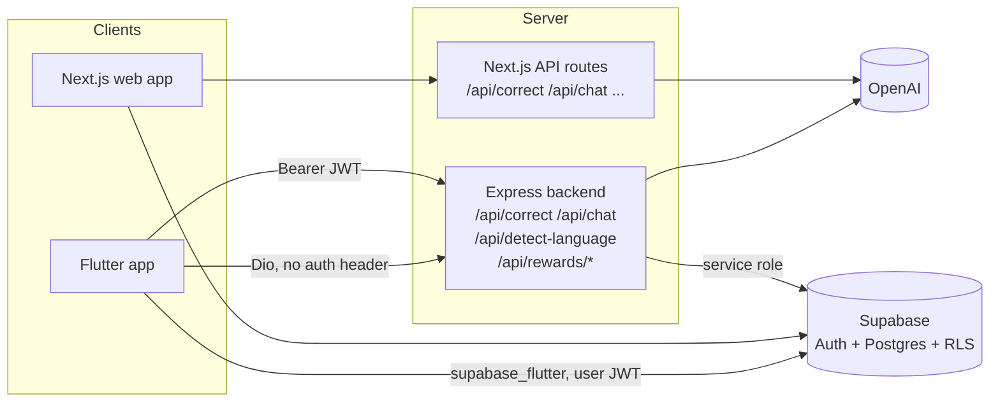
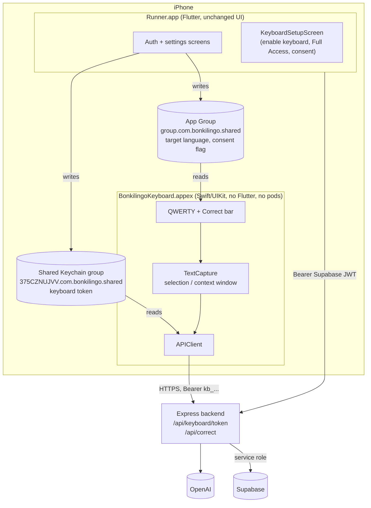

# Bonkilingo architecture and iOS keyboard proposal

Status: **proposal, awaiting review** (2026-11-19). No keyboard code exists yet.
Companion plan: [BONKILINGO_ROADMAP.md](BONKILINGO_ROADMAP.md).

Labels used below: **Verified** = read in our code or in official Apple/Flutter docs (linked).
**Assumption** = developer reports or our inference; must be confirmed on a real device.

---

## 1. Current architecture (inspected, not assumed)

Three repos share one Supabase project.

| Repo | Stack | Role |
|---|---|---|
| `bonkilingo-flutter` | Flutter 3.35.7, Riverpod, Dio, supabase_flutter 2.10.3 | iOS/Android app (bundle `com.bonkilingo.ios` (iOS), team `375CZNUJVV` (Qendresa Qytetare)) |
| `bonkilingo-backend` | Node/Express (`index.js`, `ai.js`, `rewards-routes.js`) | AI endpoints + BONK rewards (Solana). Runs locally on :3001; Vercel-ready (`export default app` when `VERCEL` is set) |
| `bonkilingua` | Next.js | Web app. **Has its own** `/api/correct`, `/api/chat`, `/api/detect-language` routes calling OpenAI directly |

### Correction flow today (Verified)

1. Flutter `HomeScreen` → `CorrectionRepository.correctText` → `AIApi` → `POST {API_BASE_URL}/api/correct`
   with `{ text, language, model }`.
2. Express `/api/correct` (`bonkilingo-backend/index.js:62`) sends a fixed system prompt
   ("professional language tutor… return ONLY the corrected text") to `completeChat()` in `ai.js`,
   which tries `gpt-6-luna` → `gpt-6.1-terra` → `gpt-4o-mini`.
3. Response: `{ corrected, wordCount, model }`.
4. The app saves the pair to Supabase `chat_sessions` **directly from the client** (RLS: user can
   insert/select own rows) and to local Hive history (last 100).
5. Explanations are a separate flow: the explanation screen calls `POST /api/chat` with the
   original/corrected text.
6. Rewards: `POST /api/rewards/earn` with the Supabase JWT (`requireAuth` → `supabase.auth.getUser`).

### Findings that matter for the keyboard

| # | Finding | Impact |
|---|---|---|
| F1 | `/api/correct`, `/api/chat`, `/api/detect-language` have **no authentication** and `cors()` allows every origin. | Once a production URL ships inside the app (and a keyboard that sends text from every app), anyone can spend the OpenAI quota. Must add auth + rate limiting before release. |
| F2 | The `language` field is **ignored** by `/api/correct` (only logged). | The "Target Language" picker has no effect on corrections today. The keyboard's language selector would be equally inert. |
| F3 | The backend logs the first 50 characters of every text (`console.log('Correcting text …')`). | Incompatible with "don't retain keystrokes" (Apple open-access guidance, guideline 5.1.2). Remove before the keyboard ships. |
| F4 | Two independent correction implementations exist (Express and Next.js API routes), with separately maintained prompts and model lists. | The handover says "don't introduce a second AI backend" — there already are two. The keyboard should use Express; consolidating the web app onto it is recommended separately. |
| F5 | supabase_flutter keeps the session in `SharedPreferencesLocalStorage` (standard UserDefaults), not the Keychain. | A keyboard extension cannot read it. Credentials must be written to a shared Keychain access group explicitly. |
| F6 | Supabase refresh tokens are single-use (rotation). | **Assumption:** if the app and the keyboard both refresh the same session, one invalidates the other. The keyboard must not hold the refresh token. |
| F7 | No `Runner.entitlements`; App Transport Security only allows `supabase.co`; production API URL is `http://localhost:3001`. | A hosted HTTPS backend is required for both TestFlight and the keyboard. |
| F8 | `flutter_secure_storage` 9.2.4 supports `IOSOptions(groupId:)` → `kSecAttrAccessGroup`. | Flutter can write to a shared Keychain group without new native code. |

---

## 2. What an iOS custom keyboard can and cannot do

| Question | Answer | Status |
|---|---|---|
| What text can it read? | Only `textDocumentProxy.documentContextBeforeInput`, `documentContextAfterInput` and `selectedText`: a window around the cursor, **not the whole field**. | Verified ([Apple](https://developer.apple.com/documentation/uikit/handling-text-interactions-in-custom-keyboards)) |
| How big is that window? | Not documented. Reports: ~200 chars, or only the last 1–2 sentences after a paste, varying by host app (WhatsApp, Telegram, Signal). | Assumption ([forum](https://developer.apple.com/forums/thread/772158)) |
| Read further? | Possible by stepping the cursor with `adjustTextPosition(byCharacterOffset:)` and re-reading, then restoring. Fragile, async, host-dependent. | Method verified; technique unsupported |
| New iOS 26 API for full text? | None found. | Verified (absence) |
| Replace text? | `deleteBackward()` deletes one character before the cursor; `insertText(_:)` inserts at the cursor. Replacing = move cursor to end, delete N, insert corrected. | Verified API; procedure is ours |
| Partial selection? | `selectedText` is readable; `insertText` over a selection normally replaces it, but it's host-defined. | Assumption, test per app |
| Network requests? | Only with **Full Access** (`RequestsOpenAccess = YES` + user toggles "Allow Full Access" in Settings). Check `hasFullAccess` at runtime. | Verified ([Apple](https://developer.apple.com/documentation/uikit/configuring-open-access-for-a-custom-keyboard)) |
| Without Full Access? | No network, no writes to the shared App Group container (reads OK), no pasteboard. The keyboard must still type (guideline 4.4.1). | Verified |
| Share login with the app? | Yes, via a shared Keychain access group (`375CZNUJVV.com.bonkilingo.shared`) or App Group. Both targets need the entitlement. | Verified ([Apple](https://developer.apple.com/documentation/security/sharing-access-to-keychain-items-among-a-collection-of-apps)) |
| Where is it unavailable? | Secure (password) fields, phone-pad fields, and any app that rejects third-party keyboards via `application(_:shouldAllowExtensionPointIdentifier:)` (common in banking apps). WhatsApp/iMessage/Gmail/Instagram are expected to allow it. | Mechanism verified; per-app behavior is an assumption |
| Memory? | No published limit. Plan for ≤ 40–50 MB. **No Flutter engine in the keyboard** (Flutter docs advise ≥100 MB for Flutter UI in extensions). Measured: the Phase 1 keyboard uses **7.1 MiB** physical footprint (iPhone 14 Pro, iOS 26.5, release build). | Limit: assumption + [Flutter docs](https://docs.flutter.dev/platform-integration/ios/app-extensions). Usage: measured |
| Open the Bonkilingo app from the keyboard? | Not supported for keyboards (`NSExtensionContext.open` is Today/iMessage only), and 4.4.1 forbids launching apps other than Settings. Show "Open Bonkilingo to sign in" text instead. | Verified |

### App Store requirements (guidelines 4.4.1, 5.1.1, 5.1.2, 2.5.18)

- Must provide real keyboard input (a usable QWERTY), a next-keyboard (globe) key when
  `needsInputModeSwitchKey` is true, and **remain functional without Full Access**.
- May use keystroke data only to improve the keyboard; no ads in the keyboard.
- Must **clearly disclose sharing with third-party AI (OpenAI) and get explicit permission**
  (5.1.2(i)); privacy policy must cover collection, retention, deletion, consent withdrawal.
- App Privacy label: declare "User Content – other user content", linked to the user, used for
  App Functionality. Add a `PrivacyInfo.xcprivacy` to the extension if it uses UserDefaults.
- Risk: a keyboard whose only value is a "Correct" button may be judged thin. A clean typing
  experience is part of the product, not an afterthought.

---

## 3. Proposed architecture

### 3.1 Integration with the Flutter project

- Add an Xcode target **`BonkilingoKeyboard`** (Custom Keyboard Extension, Swift/UIKit) to
  `ios/Runner.xcodeproj`, bundle ID `com.bonkilingo.ios.keyboard`, same team, same deployment target.
- Follow the [Flutter app-extension guide](https://docs.flutter.dev/platform-integration/ios/app-extensions):
  move "Embed Foundation Extensions" before the script phases (avoids the known
  `Thin Binary` build cycle), run `flutter build ios --config-only`.
- Podfile: the keyboard target gets **no** Flutter plugin pods (memory, binary size).
- Flutter talks to the extension only through shared storage. No method channels are needed for the MVP.

### 3.2 Authentication (recommended: backend-issued keyboard token)

The keyboard must not refresh the Supabase session (F6). Proposal:

1. Flutter, after sign-in, calls `POST /api/keyboard/token` with the user's Supabase JWT.
2. Backend generates a random opaque token `kb_…`, stores only its hash in a new table
   `keyboard_tokens (id, user_id, token_hash, created_at, last_used_at, revoked_at)`, returns it once.
3. Flutter writes it with `flutter_secure_storage` using `IOSOptions(groupId: '375CZNUJVV.com.bonkilingo.shared', accessibility: first_unlock)`.
4. Keyboard reads it from the Keychain (same service name `flutter_secure_storage_service`) and
   sends `Authorization: Bearer kb_…`.
5. Sign-out in the app revokes the token (`DELETE /api/keyboard/token`) and deletes the Keychain item.

Alternative (smaller, weaker): mirror the Supabase access token into the shared Keychain on every
`tokenRefreshed` event; the keyboard uses it read-only and degrades when it expires after ~1 h
if the app hasn't been opened. Not recommended as the long-term design.

### 3.3 Request and response

`POST /api/correct` keeps its shape and gains:

- **Auth middleware** accepting either a Supabase JWT (app) or a `kb_` token (keyboard), plus
  per-user rate limiting (reuse the `reward_rate_limits` pattern). Anonymous access is removed or capped.
- **`language` actually used** in the prompt ("Correct this text written in {language}"), with
  `auto` meaning "keep the input language".
- **No text in logs** (F3). Log length and latency only.
- Optional field `source: "keyboard"` for analytics/history.

### 3.4 Capturing and replacing text in the keyboard

1. If `selectedText` is non-empty, correct only the selection; `insertText(corrected)` replaces it.
2. Otherwise take `before + after` from the context window.
3. Show **original vs corrected** in the keyboard's suggestion bar/panel. Nothing is replaced until the user taps **Accept**.
4. Replace: move the cursor to the end of `after` (`adjustTextPosition`), call `deleteBackward()`
   `(before + after).count` times (grapheme-cluster aware), `insertText(corrected)`.
5. Re-read the proxy. If the field doesn't match the expectation (host quirk, truncation),
   show "Copy corrected text" as a fallback (pasteboard needs Full Access, which we already require).
6. If the captured text looks truncated (the window starts mid-sentence or at the ~200-char boundary),
   warn: "Only the last part of your message was corrected. Select the text to correct all of it."

### 3.5 History and learning data

- MVP: none from the keyboard.
- Phase 2: backend inserts a `chat_sessions` row with `source = 'keyboard'` (new column) using the
  service role, **only if the user opted in** in the app. The Flutter History screen then shows
  keyboard corrections. Rewards can be granted server-side for keyboard corrections the same way.

### 3.6 Privacy and security

- Consent: the Flutter `KeyboardSetupScreen` explains that typed text is sent to Bonkilingo's
  server and OpenAI when you tap Correct (never automatically), and records consent in the App Group.
  The keyboard refuses to send anything until that flag is set.
- Text leaves the device **only on an explicit tap** of Correct, never while typing.
- No server-side storage of keyboard text unless the user opted into history; no text in logs.
- Keyboard token is revocable, hashed at rest, scoped to correction endpoints only.
- HTTPS only; ATS stays strict (no `NSAllowsArbitraryLoads`).
- Secure fields are never seen by the keyboard (iOS swaps in the system keyboard).

---

## 4. Top risks and blockers

| Risk | Severity | Mitigation |
|---|---|---|
| Context window truncation (can't reliably read long or pasted messages) | High | Selection-first UX, truncation warning, measure per host app early in Phase 1 |
| Users won't grant Full Access | High | Clear setup screen; keyboard still types without it; explain why |
| App Review (4.4.1 completeness, 5.1.2 AI disclosure) | Medium | Real QWERTY, globe key, consent screen naming OpenAI, privacy policy update |
| Unauthenticated correction API (F1) | High (cost) | Auth + rate limiting before any public build, keyboard or not |
| Memory limit / extension killed | Low (measured 7.1 MiB) | Pure UIKit, no Flutter/pods; re-measure after Phase 2 adds networking |
| Typing feel (edge-key delay, rollover) | Low (fixed in Phase 1) | Window gesture recognizers don't delay touches; rollover commits held keys; key previews |
| Replacement quirks (emoji, marked text, host apps) | Medium | Grapheme-aware deletion, verify-after-replace, copy fallback |
| No hosted HTTPS backend yet (F7) | Blocker | Deploy Express to Vercel (already supported) before Phase 1 device testing |

## 5. Decisions needed from you

1. **Backend host for production** (Vercel is already supported by the code) and the domain.
2. **Auth approach:** backend keyboard token (recommended) vs mirrored Supabase access token.
3. **Canonical AI backend:** keep Express as the single correction service and later point the Next.js app at it (recommended), or keep both.
4. Whether keyboard corrections should appear in History / earn BONK (Phase 2).
